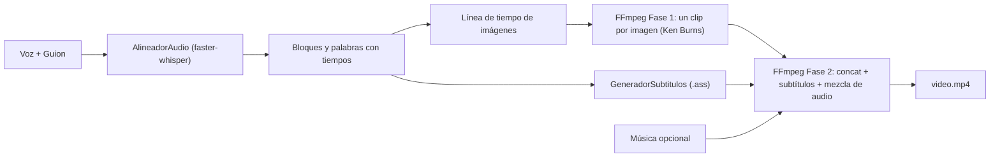

# 🎬 Generador de Videos Automático

Aplicación de escritorio **de uso personal** (Python + CustomTkinter) que genera videos automáticamente combinando:

- 🎙️ **Audio principal** (voz / locución)
- 📝 **Guion escrito** (archivo `.txt` o texto pegado en la interfaz)
- 🖼️ **Imágenes de apoyo** (ordenables)
- 🎵 **Música de fondo** (opcional, con volumen ajustable)
- 💬 **Subtítulos dinámicos** (opcionales, con la palabra activa resaltada)

El pipeline se basa en estándares profesionales de postproducción automatizada:
**Whisper (faster-whisper)** para la alineación forzada guion ↔ audio y **FFmpeg CLI** para el renderizado.

---

## ✨ Características

| Función | Detalle |
|---|---|
| Alineación forzada | `faster-whisper` local con marcas de tiempo por palabra; el guion se empareja con la transcripción (`difflib`) y las palabras no reconocidas se interpolan. Los subtítulos usan **el texto exacto del guion**. |
| CPU / GPU | Detección automática de GPU CUDA (`float16`); si falla, se usa CPU (`int8`). |
| Sincronización de imágenes | Cada imagen cambia al empezar un bloque del guion. Si hay más bloques que imágenes (o al revés), las duraciones se ajustan proporcionalmente: **nunca hay pantallas en negro**. |
| Efecto Ken Burns | Acercamientos, alejamientos y paneos suaves alternados (`zoompan` con sobremuestreo anti-temblor). Se puede desactivar. |
| Música de fondo | Se repite en loop / recorta a la duración de la voz, con fundidos de entrada/salida, volumen configurable (por defecto 18 %) y limitador anti-saturación. Si no se elige música, se exporta solo la voz. |
| Subtítulos | Archivo `.ass` estilizado (escala con la resolución, margen seguro para TikTok/Reels) quemado con `libass`. Se puede desactivar para exportar el video limpio. |
| Formatos | **9:16** 1080×1920 (TikTok, Reels, Shorts) · **16:9** 1920×1080 Full HD (YouTube estándar) · **1:1** 1080×1080 (Post) · **4:5** 1080×1350 (Instagram Feed) |
| Audio principal | Selector de voz (`.mp3`, `.wav`, `.m4a`) con lectura de duración, botón para cambiar y botón **✕ Quitar**. |
| Sin base de datos | Todo funciona con el sistema de archivos local; los temporales se eliminan al terminar. |

---

## 🏗️ Arquitectura (MVC)

```text
generador_videos/
├── modelo/                      # Lógica de negocio (NO importa customtkinter)
│   ├── proyecto_video.py        # Entidad/DTO + validaciones + formatos
│   ├── alineador_audio.py       # Alineación forzada voz ↔ guion (faster-whisper)
│   ├── generador_subtitulos.py  # Subtítulos dinámicos .ass
│   └── motor_ffmpeg.py          # Línea de tiempo de imágenes + pipeline FFmpeg
├── vista/                       # Interfaz CustomTkinter (NO ejecuta FFmpeg ni Whisper)
│   ├── ventana_principal.py
│   ├── paneles.py
│   └── estilos.py
├── controlador/
│   └── controlador_video.py     # Orquesta Vista ↔ Modelo, hilos y estados
├── utilidades/
│   ├── verificador_sistema.py   # FFmpeg, libass y GPU CUDA
│   └── gestor_temporales.py     # Carpetas temporales con limpieza automática
├── pruebas/                     # Pruebas unitarias y de integración del Modelo
├── principal.py                 # Punto de entrada
└── requirements.txt
```

**Reglas de diseño**

- La **Vista** nunca importa FFmpeg ni Whisper; el **Modelo** nunca importa `customtkinter`.
- El **Controlador** ejecuta la IA y el renderizado en `threading.Thread` y actualiza la Vista de forma segura con `after()`.
- Código, nombres y comentarios **en español**.

### Flujo de procesamiento



---

## 📦 Estado del proyecto

- [x] `requirements.txt`
- [x] `utilidades/` (verificador del sistema, gestor de temporales)
- [x] `modelo/` completo (proyecto, alineador, subtítulos, motor FFmpeg) + pruebas
- [x] `vista/` (CustomTkinter)
- [x] `controlador/` (hilos, cola segura con `after()`, cancelación)
- [x] `principal.py`
- [ ] Pruebas reales de extremo a extremo con FFmpeg

📈 El detalle de cada fase, decisiones técnicas y próximos pasos está en **[PROGRESO.md](PROGRESO.md)**.

---

## 🚀 Instalación

### Requisitos

- Python **3.10+**
- **FFmpeg ≥ 5.0** con `libass` (incluido en las builds de gyan.dev) accesible en el PATH:
  ```powershell
  winget install Gyan.FFmpeg
  ```
  También se puede indicar la carpeta de los binarios con la variable de entorno `RUTA_FFMPEG`.
- (Opcional) GPU NVIDIA con CUDA 12 + cuDNN 9 para acelerar Whisper.

### Pasos

```powershell
python -m venv venv
.\venv\Scripts\Activate.ps1
pip install -r generador_videos\requirements.txt
```

La primera alineación descarga automáticamente el modelo de Whisper elegido (por defecto `small`, ~460 MB).

### Ejecutar la aplicación

```powershell
.\venv\Scripts\Activate.ps1
python generador_videos\principal.py
```

**Uso:** selecciona el audio de voz → escribe o carga el guion → agrega imágenes (y ordénalas con ▲▼) → opcionalmente elige música y volumen → elige formato, subtítulos, Ken Burns, modelo de IA y carpeta → **🎬 Generar video**.

---

## 🧪 Pruebas

Desde la carpeta `generador_videos`:

```powershell
# Pruebas unitarias del Modelo y del Controlador (no requieren FFmpeg ni Whisper)
python -m unittest discover -s pruebas -v

# Verificar el entorno
python -c "from utilidades import verificar_sistema; print(verificar_sistema().resumen())"

# Pipeline completo de extremo a extremo (requiere FFmpeg)
python pruebas\prueba_pipeline_modelo.py --voz voz.mp3 --guion guion.txt --imagenes .\imagenes --salida C:\Videos --formato 9:16 --musica musica.mp3
```

Opciones de la prueba de integración: `--sin-subtitulos`, `--sin-ken-burns`, `--modelo tiny|base|small|medium|large-v3`, `--idioma es`, `--sin-ia` (reparto proporcional sin Whisper).

---

## 📝 Consejos para el guion

- Separa los bloques con **una línea en blanco**: cada bloque es una unidad de sincronización para las imágenes.
- Si el guion es un solo párrafo, se divide automáticamente por líneas u oraciones.
- Lo ideal es tener una imagen por bloque, aunque el sistema se adapta a cualquier cantidad.
